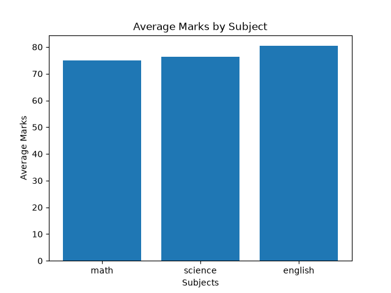
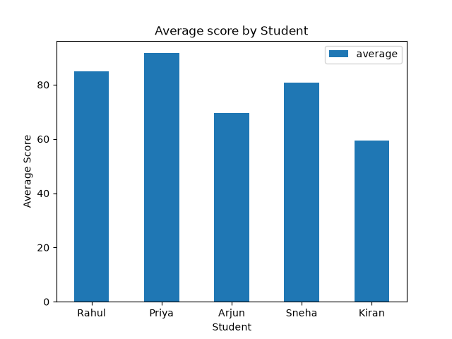
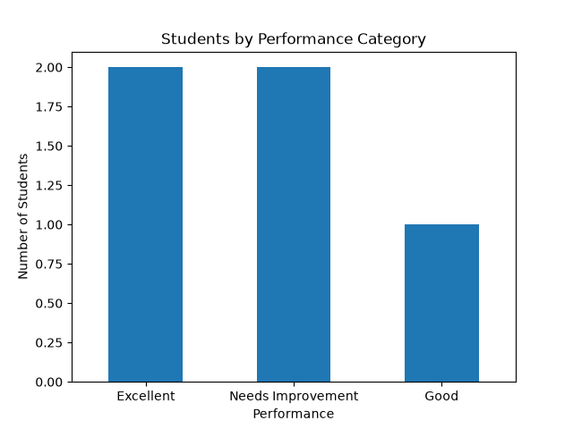

# Student Performance Analysis

A beginner-friendly data analysis project built with **Python, Pandas, and Matplotlib**. The project explores a sample student marks dataset, calculates performance metrics, ranks students, and creates charts to communicate the results.

## Project Overview

The script analyzes marks in Mathematics, Science, and English for each student. It calculates averages, assigns performance categories, identifies the highest-performing student and subject, and summarizes class performance.

## Features

- Load student marks from a CSV file using Pandas
- Check the dataset for missing values
- Calculate each student's average marks
- Assign performance categories:
  - **Excellent:** average of 85 or above
  - **Good:** average of 70 to below 85
  - **Needs Improvement:** average below 70
- Calculate subject-wise averages and identify the highest-average subject
- Identify the top-performing student and top three students
- Rank students by average marks
- Identify each student's strongest subject
- Calculate subject correlations and class statistics
- Create charts with Matplotlib
- Export analysis results to CSV reports

## Technologies Used

- Python
- Pandas
- Matplotlib
- CSV
- Visual Studio Code

## Project Files

```text
DatascienceJourney/
├── main.py
├── students.csv
├── README.md
├── student_analysis_results.csv       # generated when the script runs
├── students_performance_report.csv   # generated when the script runs
└── charts/
    ├── subject_average.png            # generated chart
    ├── students_average.png           # generated chart
    └── performance_category.png       # generated chart
```

The two CSV reports and chart images are generated by `main.py`. Make sure the `charts` folder exists before running the script.

## Getting Started

### 1. Install Python

Install Python 3 and make sure it is available from your terminal.

### 2. Download the project

Clone the repository:

```bash
git clone https://github.com/sameersyedd77/DatascienceJourney.git
cd DatascienceJourney
```

Alternatively, download the repository as a ZIP file from GitHub and open the extracted folder in VS Code.

### 3. Install dependencies

```bash
python -m pip install pandas matplotlib
```

### 4. Create the charts folder

If it is not already present, create a folder named `charts` in the project directory.

### 5. Run the analysis

```bash
python main.py
```

The script prints the analysis in the terminal and saves the result CSV files and chart images.

## Insights from the Sample Dataset

The current sample contains five students and three subjects.

- **Priya** has the highest overall average, approximately **91.67**.
- **English** has the highest subject average, at **80.40**.
- Student averages, rankings, performance categories, strongest subjects, and subject correlations are calculated by the script.

These insights describe only the sample data in `students.csv`; results will change if the dataset is updated.

## Visualizations

After running the script, the charts are saved in the `charts` folder.

### Average Marks by Subject



### Average Score by Student



### Students by Performance Category



## Future Improvements

- Build an interactive dashboard using Streamlit or Power BI
- Analyze a larger student dataset
- Add more data-cleaning and validation steps
- Improve chart styling and reporting
- Allow users to upload their own CSV datasets

## Author

**Sameer Syed**

GitHub: [sameersyedd77](https://github.com/sameersyedd77)
